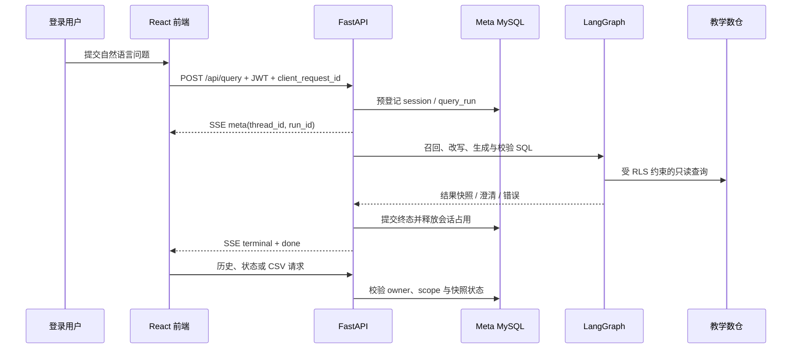

<div align='center'>
  <h1 style="margin-top: 15px;">「电商问数」智能数据分析 Agent</h1>
  <h4><b>shopkeeper-agent</b></h4>
  <p><em>可能是全网最适合用于系统学习 LangGraph 的智能问数实战项目，配套系统性文字教程与对应章节分支，带你打通混合检索、多阶段推理、SQL 生成与执行全链路</em></p>
</div>

<div align='center'>


[](https://didilili.github.io/ai-agents-from-zero/#/%E5%AE%9E%E6%88%98%E9%A1%B9%E7%9B%AE-%E7%94%B5%E5%95%86%E9%97%AE%E6%95%B0/0-%E5%89%8D%E8%A8%80)

</div>

**📢 说明**：本套实战项目已更新完成，配套教程、章节分支和前后端代码均可对照学习。

如果你正在找一个适合学习 `LangGraph`、`Qdrant`、`MySQL`、`FastAPI` 和 AI Agent 工程开发的实战项目，「电商问数」很可能是最适合你的项目。

它不是只调用一次大模型接口，也不是写几个 Prompt 演示 SQL 生成结果。这个项目围绕电商数仓问数场景，先构建元数据知识库，再做字段、指标、字段取值的混合检索，随后用 LangGraph 编排多阶段问数流程，完成 SQL 生成、校验、修正、执行和前端流式展示。换句话说，你学到的不是某一个框架 API，而是一条 AI 应用从数据准备、检索增强、智能体编排、接口交付到前端联调的完整项目主线。

> 本套仓库是 [ai-agents-from-zero](https://github.com/didilili/ai-agents-from-zero) 教程体系中的 [实战项目-电商问数](https://github.com/didilili/ai-agents-from-zero/tree/main/%E5%AE%9E%E6%88%98%E9%A1%B9%E7%9B%AE-%E7%94%B5%E5%95%86%E9%97%AE%E6%95%B0) 配套源码仓库，除了可直接运行和二次开发的项目代码之外，也提供了与教程章节对应的 Git 分支演进过程，以及完整的在线图文讲义入口。
> 如果你想系统学习「AI智能体 大模型应用开发」，也可直接从系统教程 [AI 智能体实战速成指南-大模型入门](https://didilili.github.io/ai-agents-from-zero/#/) 开始。


## 📖 项目介绍

在真实问数场景里，业务同学通常不会写 SQL，数据分析同学也很难随时记住所有表结构、字段含义、指标口径和字段取值。单纯把自然语言问题直接交给大模型，很容易出现表选错、字段选错、指标理解错和 SQL 幻觉等问题。

`电商问数` 要解决的就是这个问题：

- 用户用自然语言提问
- 系统自动召回相关字段、指标和字段取值
- 大模型基于上下文进行分步推理
- 生成 SQL 并查询数据仓库
- 以流式方式返回分析结果

## ✨ 项目亮点

- **检索 + 推理 + 生成，而不是模型直出 SQL**
    - 先围绕问题召回相关字段、指标和值域，再组织上下文生成 SQL，整体链路更稳、更可控。
- **面向企业问数场景的混合检索**
    - `Qdrant` 负责字段和指标的语义召回。
    - `Elasticsearch` 负责字段取值的全文检索。
    - `MySQL` 负责保存完整、权威的结构化元数据。
- **支持字段、指标、取值三类信息协同召回**
    - 比单纯做表级或字段级检索更贴近真实企业分析流程。
- **从检索到执行的完整可运行链路**
    - 不停留在 Prompt 设计，而是会真实生成 SQL、执行查询，并以流式方式返回结果。
- **工程化后端结构清晰**
    - 基于 `FastAPI + LangGraph + Repository + Client Manager` 组织配置、客户端、仓储层、服务层与智能体流程，便于维护和扩展。
- **可靠的会话与断流恢复**
    - 查询先在 Meta MySQL 预登记，再通过 SSE 推送过程和终态；`client_request_id` 保证重复提交不重复执行，刷新或断流后可按同一 run 恢复结果。
- **权限、结果快照与安全导出**
    - JWT 身份决定 RLS 和列脱敏范围；历史、CSV 和表格均基于已脱敏的结果快照，不重新执行 SQL，也不会泄露原始数据。
- **面向业务迭代的语义治理**
    - 业务字典、收藏、纠错反馈和离线评测会逐步把人工经验沉淀为可回归的问数质量资产。
- **不仅有实战代码，还有完整配套教程文档**
    - 项目配有一套系统化、持续更新、完全免费的教程讲义，适合按章节从数仓基础、元数据知识库到问数智能体流程逐步学习。
- **兼顾学习价值与可扩展性**
    - 既可以按教程章节逐步理解，也可以在此基础上继续扩展权限控制、SQL 审核、结果可视化等能力。

这套课程十分适合这些场景：

- 想系统学习 `LangGraph`，但不想只停留在几个玩具节点。
- 想把 `MySQL`、`Qdrant`、`Elasticsearch` 和大模型放到同一个业务场景里理解。
- 想做一个比简单模型调用更接近实际开发的 AI Agent 项目。
- 想把项目写进简历，并且能说清楚数据层、检索层、智能体层、服务层和前端层分别做了什么。

## 🏗️ 系统架构


项目围绕两条主线展开：

| 主线             | 做什么                                                                   | 涉及模块                                     |
| ---------------- | ------------------------------------------------------------------------ | -------------------------------------------- |
| 元数据知识库构建 | 抽取教学数仓中的表、字段、指标和字段取值，写入结构化库、向量库和全文索引 | `MySQL` / `Qdrant` / `Elasticsearch` / `TEI` |
| 自然语言问数     | 基于用户问题完成召回、上下文整理、SQL 生成校验执行，并把过程流式返回前端 | `LangGraph` / `FastAPI` / `SSE` / `React`    |

### 面向演示的查询数据流



演示时按“登录 → 首问 → 追问 → 刷新恢复 → 排序/CSV → 切换账号”的顺序操作，能在几分钟内说明模型链路、权限边界与异常恢复。


## 🛠️ 项目技术栈

| 模块       | 技术                              | 作用                                           |
| ---------- | --------------------------------- | ---------------------------------------------- |
| 教学数仓   | `MySQL`                           | 模拟事实表、维度表和分析型查询环境             |
| 元数据库   | `MySQL` / `SQLAlchemy`            | 保存表、字段、指标、字段指标关系等结构化元数据 |
| 向量检索   | `Qdrant`                          | 保存字段和指标向量，支持语义召回               |
| 全文检索   | `Elasticsearch`                   | 保存字段真实取值，支持关键词和值域检索         |
| Embedding  | `TEI` / `BAAI/bge-large-zh-v1.5`  | 将字段、指标、问题等文本转成向量               |
| 智能体编排 | `LangGraph`                       | 组织多阶段问数工作流                           |
| 模型接入   | `LangChain`                       | 封装 LLM 与 Embedding 调用                     |
| 后端接口   | `FastAPI`                         | 提供问数 API、依赖注入和生命周期管理           |
| 流式协议   | `SSE`                             | 实时返回节点进度、查询结果和错误消息           |
| 前端       | `React` / `Vite` / `Tailwind CSS` | 提供聊天式问数界面和流程展示                   |
| 日志追踪   | `ContextVar` / `loguru`           | 为并发请求注入 request_id，便于排查链路        |
| 依赖管理   | `uv` / `pnpm`                     | 管理 Python 后端和前端依赖                     |

## 📁 项目结构

```text
shopkeeper-agent/
├── app/
│   ├── agent/            # LangGraph 图、状态、上下文和各类节点
│   ├── api/              # FastAPI 路由、依赖注入、生命周期和请求结构
│   ├── clients/          # MySQL、Qdrant、Elasticsearch、Embedding 客户端管理
│   ├── conf/             # 配置 dataclass 与配置加载工具
│   ├── core/             # 日志、request_id 上下文等通用能力
│   ├── entities/         # 更贴近业务语义的数据对象
│   ├── models/           # SQLAlchemy ORM 模型
│   ├── prompt/           # Prompt 加载工具
│   ├── repositories/     # MySQL、Qdrant、Elasticsearch 数据访问层
│   ├── scripts/          # 元数据知识库构建脚本
│   └── services/         # 元数据构建服务和问数查询服务
├── conf/                 # app_config.yaml、meta_config.yaml
├── docker/               # Docker Compose、MySQL 初始化 SQL、ES 插件、Embedding 挂载目录
├── frontend/             # React + Vite + Tailwind CSS 前端项目
├── prompts/              # SQL 生成、修正、过滤等 Prompt 模板
├── main.py               # FastAPI 应用入口
└── pyproject.toml        # Python 项目依赖与工具配置
```

## 🚀 快速开始

当前仓库已经包含一套可直接启动的本地开发环境，你可以按照以下顺序启动项目。

### 1. 准备环境

- Python `>= 3.14`
- `uv`
- Docker 与 Docker Compose
- Node.js 与 `pnpm`

### 2. 克隆项目

```bash
git clone https://github.com/didilili/shopkeeper-agent.git
cd shopkeeper-agent
```

### 3. 安装后端依赖

```bash
uv sync
```

### 4. 配置环境变量

在项目根目录创建 `.env` 文件（已被 `.gitignore` 忽略，不会提交到仓库）：

```bash
LLM_API_KEY=your_real_api_key
MYSQL_PASSWORD=your_mysql_password
JWT_SECRET=your_random_secret_at_least_32_chars
DEV_LOGIN_PASSWORD=demo123
```

- `LLM_API_KEY`：大模型平台的真实密钥，供 `conf/app_config.yaml` 中的 `${oc.env:LLM_API_KEY}` 解析。
- `MYSQL_PASSWORD`：MySQL 密码，需与 `docker/.env` 中的 `MYSQL_PASSWORD` 保持一致（Docker Compose 从 `docker/.env` 读取，见下一步）。
- `JWT_SECRET`：**鉴权签名密钥，必须配置**。生成方式：`python -c "import secrets; print(secrets.token_urlsafe(48))"`。缺失或短于 32 字符时服务直接拒绝启动。
- `DEV_LOGIN_PASSWORD`：演示用登录口令（见下文「鉴权（JWT）」）。生产接真实登录后可删除。

默认配置使用兼容 OpenAI 接口的硅基流动服务：

```yaml
llm:
    model_name: Pro/zai-org/GLM-5.1
    api_key: ${oc.env:LLM_API_KEY}
    base_url: https://api.siliconflow.cn/v1
```

如需使用其他兼容 OpenAI API 的模型平台，修改 [conf/app_config.yaml](conf/app_config.yaml) 中的 `model_name` 和 `base_url`。

### 5. 准备 Embedding 模型

项目通过 `TEI` 加载 `BAAI/bge-large-zh-v1.5`。模型文件体积较大，无法再仓库中进行提交，需要先下载到 Docker 挂载目录：

```bash
uv run hf download BAAI/bge-large-zh-v1.5 --local-dir docker/embedding/bge-large-zh-v1.5
```

如果手动下载，请解压到：`docker/embedding/bge-large-zh-v1.5`路径下。

### 6. 启动 Docker 基础服务

```bash
docker compose -f docker/docker-compose.yaml up -d
```

默认端口：

| 服务          | 端口   |
| ------------- | ------ |
| MySQL         | `3306` |
| Elasticsearch | `9200` |
| Kibana        | `5601` |
| Qdrant        | `6333` |
| Embedding     | `8081` |

> `docker/mysql/meta.sql` 和 `docker/mysql/dw.sql` 会在 MySQL 容器首次启动时自动初始化元数据库和教学数仓。

### 6.1 初始化会话历史表

首次创建过数据卷的 MySQL 不会再次执行初始化目录中的新 SQL 文件。启动服务后，执行一次会话迁移：

```powershell
Get-Content -Raw docker/mysql/migration_add_chat_history.sql |
  docker exec -i mysql sh -c 'mysql -uroot -p"$MYSQL_ROOT_PASSWORD" meta'
```

迁移只新增 `chat_session` 与 `query_run`，不会修改教学数仓表。重复执行是安全的。

### 7. 构建元数据知识库

```bash
uv run python -m app.scripts.build_meta_knowledge -c conf/meta_config.yaml
```

这一步会把表字段元数据写入 MySQL，把字段和指标向量写入 Qdrant，并把字段真实取值写入 Elasticsearch。

### 8. 启动后端

```bash
uv run fastapi dev main.py
```

后端接口：

```text
POST http://127.0.0.1:8000/api/auth/token   # 用账号 + 口令换取访问令牌
GET  http://127.0.0.1:8000/api/auth/me      # 查看当前令牌对应的身份
POST http://127.0.0.1:8000/api/query        # 问数（必须携带令牌）
GET  http://127.0.0.1:8000/api/sessions      # 当前账号的会话列表
GET  http://127.0.0.1:8000/api/sessions/{id}/runs
GET  http://127.0.0.1:8000/api/sessions/{id}/runs/{run_id}/export?format=csv
GET  http://127.0.0.1:8000/health
```

### 鉴权（JWT）

`/api/query` 必须携带访问令牌。**角色由服务端决定，客户端无法指定**——
请求体里没有角色字段，服务端按账号查表得出角色，写进令牌并用 `JWT_SECRET` 签名。

```bash
# 1. 换取令牌
TOKEN=$(curl -s -X POST http://127.0.0.1:8000/api/auth/token \
  -H "Content-Type: application/json" \
  -d '{"username":"boss","password":"demo123"}' \
  | python -c "import sys,json;print(json.load(sys.stdin)['access_token'])")

# 2. 带上令牌问数
curl -N -X POST http://127.0.0.1:8000/api/query \
  -H "Content-Type: application/json" \
  -H "Authorization: Bearer $TOKEN" \
  -d '{"query":"统计华北地区的销售总额"}'
```

演示账号见 `conf/app_config.yaml` 的 `auth.dev_users`，共用口令取自环境变量 `DEV_LOGIN_PASSWORD`：

| 账号      | 角色           | 数据范围                     |
| --------- | -------------- | ---------------------------- |
| `boss`    | `admin`        | 全量可见，不脱敏             |
| `east`    | `east_manager` | 仅华东（R002 / R005）        |
| `analyst` | `analyst`      | 全量可见，`customer_name` 脱敏 |
| `guest`   | `guest`        | 仅华东，且 `customer_name` 脱敏 |

失败一律 401（缺失 / 过期 / 签名不符 / 角色已失效），且**不区分具体原因**，
避免给攻击者反馈信号；真实原因只写进服务端日志。

> ⚠️ **生产环境必须把 `auth.dev_login_enable` 置为 `false`**，并把 `/api/auth/token`
> 换成对接公司 SSO / LDAP，或改查用户表并校验密码哈希（argon2 / bcrypt）。
> 下游解析身份的 `get_current_identity` 一行都不用改。
>
> `JWT_SECRET` 只放在 `.env`（已 gitignore）；缺失或短于 32 字符时服务**直接拒绝启动**。
> 项目刻意**不提供"关闭鉴权"的开关**——配置里一个 `false` 就能把系统敞开，
> 是比漏洞本身更常见的事故来源。

SSE 消息类型：

| 类型       | 含义         |
| ---------- | ------------ |
| `meta`     | 会话 id、run id |
| `progress` | 节点执行进度 |
| `result`   | 最终查询结果 |
| `clarify`  | 澄清反问     |
| `error`    | 全局异常消息 |
| `done`     | 本轮已持久化的终态、run id 与 outcome |

`meta` 同时携带 `thread_id` 和 `run_id`。每次请求应带上 UUID 格式的
`client_request_id`：网络断开或首条 SSE 丢失时，客户端用同一个请求键查询
`/api/sessions/{id}/runs/by-request/{client_request_id}`，不会重复执行问数。

### 会话历史、排序与 CSV

前端左侧可新建、切换、改名和软删除会话。历史结果来自 Meta MySQL 中已保存的
脱敏快照；刷新页面或后端重启后可以继续查看，权限范围变化时旧会话会被服务端拒绝。

结果表支持按列升序、降序和恢复原顺序，并可选择每页 20 / 50 / 100 行。金额使用
十进制字符串排序，不转换为 JavaScript 浮点数。点击结果气泡右上角的“导出 CSV”会
下载本次查询保存的全部展示行，保持列顺序和脱敏结果，不会重新执行 SQL。

### 9. 启动前端

```bash
cd frontend
pnpm install
pnpm dev
```

前端默认通过 Vite 代理把 `/api` 转发到 `http://127.0.0.1:8000`。如需修改：

```bash
cd frontend
cp .env .env
```

```bash
VITE_DEV_PROXY_TARGET=http://127.0.0.1:8000
```

## 📚 配套教程目录

教程总入口：[电商问数完整教程](https://didilili.github.io/ai-agents-from-zero/#/%E5%AE%9E%E6%88%98%E9%A1%B9%E7%9B%AE-%E7%94%B5%E5%95%86%E9%97%AE%E6%95%B0/0-%E5%89%8D%E8%A8%80)

| 章节 | 标题                                                                                                                                                                                                                                                                              | 学习重点                                                                 | 对应分支                           |
| ---- | --------------------------------------------------------------------------------------------------------------------------------------------------------------------------------------------------------------------------------------------------------------------------------- | ------------------------------------------------------------------------ | ---------------------------------- |
| 0    | [前言](https://didilili.github.io/ai-agents-from-zero/#/%E5%AE%9E%E6%88%98%E9%A1%B9%E7%9B%AE-%E7%94%B5%E5%95%86%E9%97%AE%E6%95%B0/0-%E5%89%8D%E8%A8%80)                                                                                                                           | 项目定位、学习价值与能力边界                                             | `-`                                |
| 1    | [项目概述与数仓基础](https://didilili.github.io/ai-agents-from-zero/#/%E5%AE%9E%E6%88%98%E9%A1%B9%E7%9B%AE-%E7%94%B5%E5%95%86%E9%97%AE%E6%95%B0/1-%E9%A1%B9%E7%9B%AE%E6%A6%82%E8%BF%B0%E4%B8%8E%E6%95%B0%E4%BB%93%E5%9F%BA%E7%A1%80)                                              | 业务库、数仓、事实表、维度表与教学数仓设计                               | `-`                                |
| 2    | [项目整体架构与智能体流程](https://didilili.github.io/ai-agents-from-zero/#/%E5%AE%9E%E6%88%98%E9%A1%B9%E7%9B%AE-%E7%94%B5%E5%95%86%E9%97%AE%E6%95%B0/2-%E9%A1%B9%E7%9B%AE%E6%95%B4%E4%BD%93%E6%9E%B6%E6%9E%84%E4%B8%8E%E6%99%BA%E8%83%BD%E4%BD%93%E6%B5%81%E7%A8%8B)             | MySQL、Qdrant、Elasticsearch、LLM 与 Agent 工作流如何协作                | `-`                                |
| 3    | [开发环境与基础服务准备](https://didilili.github.io/ai-agents-from-zero/#/%E5%AE%9E%E6%88%98%E9%A1%B9%E7%9B%AE-%E7%94%B5%E5%95%86%E9%97%AE%E6%95%B0/3-%E5%BC%80%E5%8F%91%E7%8E%AF%E5%A2%83%E4%B8%8E%E5%9F%BA%E7%A1%80%E6%9C%8D%E5%8A%A1%E5%87%86%E5%A4%87)                        | uv、Docker Compose、MySQL、Qdrant、Elasticsearch、Kibana、Embedding 服务 | `03-env-services`                  |
| 4    | [项目结构与基础服务配置管理](https://didilili.github.io/ai-agents-from-zero/#/%E5%AE%9E%E6%88%98%E9%A1%B9%E7%9B%AE-%E7%94%B5%E5%95%86%E9%97%AE%E6%95%B0/4-%E9%A1%B9%E7%9B%AE%E7%BB%93%E6%9E%84%E4%B8%8E%E5%9F%BA%E7%A1%80%E6%9C%8D%E5%8A%A1%E9%85%8D%E7%BD%AE%E7%AE%A1%E7%90%86)  | 工程结构、YAML 配置、OmegaConf 与 dataclass 配置加载                     | `04-structure-config`              |
| 5    | [Qdrant 与 ES 快速入门与接入](https://didilili.github.io/ai-agents-from-zero/#/%E5%AE%9E%E6%88%98%E9%A1%B9%E7%9B%AE-%E7%94%B5%E5%95%86%E9%97%AE%E6%95%B0/5-Qdrant%E4%B8%8EES%E5%BF%AB%E9%80%9F%E5%85%A5%E9%97%A8%E4%B8%8E%E6%8E%A5%E5%85%A5)                                      | 向量检索、全文检索与客户端管理                                           | `05-qdrant-es`                     |
| 6    | [MySQL、Embedding 接入与日志管理](https://didilili.github.io/ai-agents-from-zero/#/%E5%AE%9E%E6%88%98%E9%A1%B9%E7%9B%AE-%E7%94%B5%E5%95%86%E9%97%AE%E6%95%B0/6-MySQL%E3%80%81Embedding%E4%B8%8E%E6%97%A5%E5%BF%97%E7%AE%A1%E7%90%86)                                              | 异步 MySQL、TEI Embedding、loguru 日志                                   | `06-mysql-embedding-log`           |
| 7    | [元数据知识库总览与构建入口](https://didilili.github.io/ai-agents-from-zero/#/%E5%AE%9E%E6%88%98%E9%A1%B9%E7%9B%AE-%E7%94%B5%E5%95%86%E9%97%AE%E6%95%B0/7-%E5%85%83%E6%95%B0%E6%8D%AE%E7%9F%A5%E8%AF%86%E5%BA%93%E6%80%BB%E8%A7%88%E4%B8%8E%E6%9E%84%E5%BB%BA%E5%85%A5%E5%8F%A3)  | 元数据知识库产物、存储分工和构建入口                                     | `07-metadata-base-overview`        |
| 8    | [表与字段信息同步到元数据库](https://didilili.github.io/ai-agents-from-zero/#/%E5%AE%9E%E6%88%98%E9%A1%B9%E7%9B%AE-%E7%94%B5%E5%95%86%E9%97%AE%E6%95%B0/8-%E8%A1%A8%E4%B8%8E%E5%AD%97%E6%AE%B5%E4%BF%A1%E6%81%AF%E5%90%8C%E6%AD%A5%E5%88%B0%E5%85%83%E6%95%B0%E6%8D%AE%E5%BA%93)  | Service、Repository、Mapper、ORM 如何配合入库                            | `08-metadata-table-column-sync`    |
| 9    | [字段与指标检索能力构建](https://didilili.github.io/ai-agents-from-zero/#/%E5%AE%9E%E6%88%98%E9%A1%B9%E7%9B%AE-%E7%94%B5%E5%95%86%E9%97%AE%E6%95%B0/9-%E5%AD%97%E6%AE%B5%E4%B8%8E%E6%8C%87%E6%A0%87%E6%A3%80%E7%B4%A2%E8%83%BD%E5%8A%9B%E6%9E%84%E5%BB%BA)                        | 字段向量索引、字段值全文索引和指标向量索引                               | `09-metadata-retrieval-capability` |
| 10   | [问数智能体总览与工作流骨架](https://didilili.github.io/ai-agents-from-zero/#/%E5%AE%9E%E6%88%98%E9%A1%B9%E7%9B%AE-%E7%94%B5%E5%95%86%E9%97%AE%E6%95%B0/10-%E9%97%AE%E6%95%B0%E6%99%BA%E8%83%BD%E4%BD%93%E6%80%BB%E8%A7%88%E4%B8%8E%E5%B7%A5%E4%BD%9C%E6%B5%81%E9%AA%A8%E6%9E%B6) | LangGraph 工作流骨架与节点设计                                           | `10-agent-workflow-skeleton`       |
| 11   | [关键词抽取与多路召回](https://didilili.github.io/ai-agents-from-zero/#/%E5%AE%9E%E6%88%98%E9%A1%B9%E7%9B%AE-%E7%94%B5%E5%95%86%E9%97%AE%E6%95%B0/11-%E5%85%B3%E9%94%AE%E8%AF%8D%E6%8A%BD%E5%8F%96%E4%B8%8E%E5%A4%9A%E8%B7%AF%E5%8F%AC%E5%9B%9E)                                  | 关键词抽取，字段、指标和字段取值并行召回                                 | `11-agent-keyword-multi-recall`    |
| 12   | [召回信息合并与上下文构建](https://didilili.github.io/ai-agents-from-zero/#/%E5%AE%9E%E6%88%98%E9%A1%B9%E7%9B%AE-%E7%94%B5%E5%95%86%E9%97%AE%E6%95%B0/12-%E5%8F%AC%E5%9B%9E%E4%BF%A1%E6%81%AF%E5%90%88%E5%B9%B6%E4%B8%8E%E4%B8%8A%E4%B8%8B%E6%96%87%E6%9E%84%E5%BB%BA)            | 召回结果合并、依赖字段补齐和值域上下文构建                               | `12-agent-merge-retrievals`        |
| 13   | [SQL 生成前的信息过滤与补全](https://didilili.github.io/ai-agents-from-zero/#/%E5%AE%9E%E6%88%98%E9%A1%B9%E7%9B%AE-%E7%94%B5%E5%95%86%E9%97%AE%E6%95%B0/13-SQL%E7%94%9F%E6%88%90%E5%89%8D%E7%9A%84%E4%BF%A1%E6%81%AF%E8%BF%87%E6%BB%A4%E4%B8%8E%E8%A1%A5%E5%85%A8)                | 候选表字段过滤、指标过滤、日期和数据库上下文补齐                         | `13-agent-filter-extra-context`    |
| 14   | [SQL 生成与执行闭环](https://didilili.github.io/ai-agents-from-zero/#/%E5%AE%9E%E6%88%98%E9%A1%B9%E7%9B%AE-%E7%94%B5%E5%95%86%E9%97%AE%E6%95%B0/14-SQL%E7%94%9F%E6%88%90%E4%B8%8E%E6%89%A7%E8%A1%8C%E9%97%AD%E7%8E%AF)                                                            | SQL 生成、EXPLAIN 校验、错误修正和最终执行                               | `14-agent-sql-loop`                |
| 15   | [API 接口基础与 FastAPI 入门](https://didilili.github.io/ai-agents-from-zero/#/%E5%AE%9E%E6%88%98%E9%A1%B9%E7%9B%AE-%E7%94%B5%E5%95%86%E9%97%AE%E6%95%B0/15-API%E6%8E%A5%E5%8F%A3%E5%9F%BA%E7%A1%80%E4%B8%8EFastAPI%E5%85%A5%E9%97%A8)                                            | `/api/query`、StreamingResponse 和 SSE 基础                              | `15-api-streaming-basics`          |
| 16   | [查询接口实现与依赖组装](https://didilili.github.io/ai-agents-from-zero/#/%E5%AE%9E%E6%88%98%E9%A1%B9%E7%9B%AE-%E7%94%B5%E5%95%86%E9%97%AE%E6%95%B0/16-%E6%9F%A5%E8%AF%A2%E6%8E%A5%E5%8F%A3%E5%AE%9E%E7%8E%B0%E4%B8%8E%E4%BE%9D%E8%B5%96%E7%BB%84%E8%A3%85)                       | QueryService、依赖注入和应用生命周期资源管理                             | `16-api-query-service`             |
| 17   | [前后端联调与日志追踪](https://didilili.github.io/ai-agents-from-zero/#/%E5%AE%9E%E6%88%98%E9%A1%B9%E7%9B%AE-%E7%94%B5%E5%95%86%E9%97%AE%E6%95%B0/17-%E5%89%8D%E5%90%8E%E7%AB%AF%E8%81%94%E8%B0%83%E4%B8%8E%E6%97%A5%E5%BF%97%E8%BF%BD%E8%B8%AA)                                  | SSE 消息协议、前端展示、异常兜底和 request_id 日志追踪                   | `17-api-integration-logging`       |

可以用分支切换对照每一阶段的代码演进：

```bash
git checkout 04-structure-config
git checkout main
```

`main` 分支保留当前完整闭环版本。

> 本项目基于尚硅谷「大模型智能体掌柜问数」项目，并在此基础上整理完善。

## 🚧 能力边界

这套项目主要关注智能问数的学习流程，不刻意覆盖生产治理能力，例如：

- 用户登录、角色权限和数据权限控制
- 多租户隔离
- SQL 安全审计和执行白名单
- 查询缓存、限流和性能治理
- 系统化评测集与自动化回归评测
- 监控告警、链路追踪平台和灰度发布
- 更复杂的多轮问数记忆、追问改写和会话管理

这些能力适合在基础流程跑通之后继续扩展。`shopkeeper-agent` 更适合承担一个清晰角色：先把智能问数最关键、最必要、最值得学习的工程链路讲清楚、跑起来，并为后续扩展企业级能力打基础。
